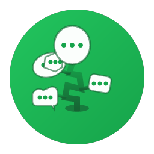
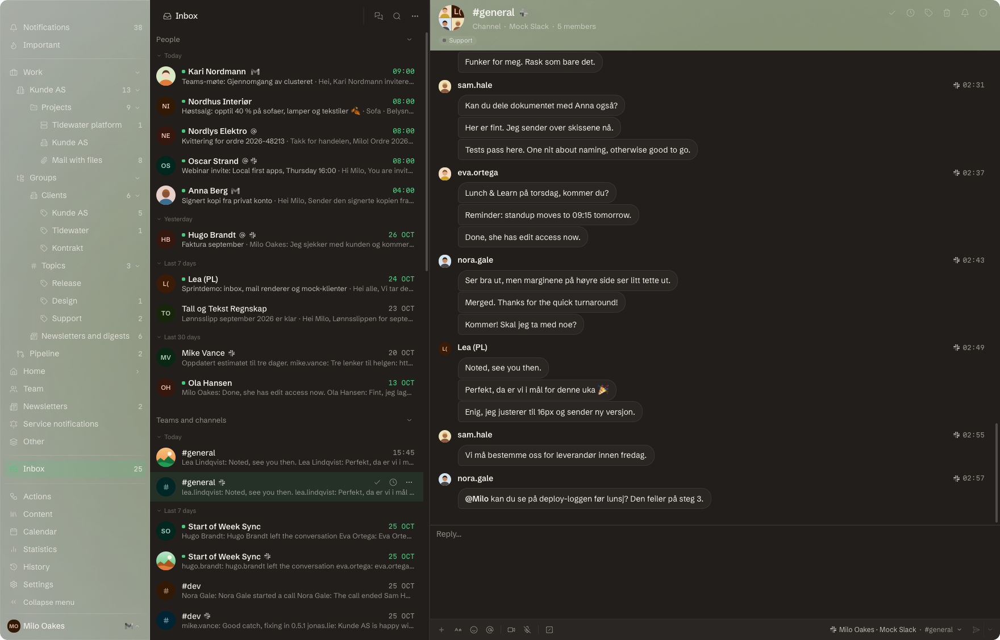
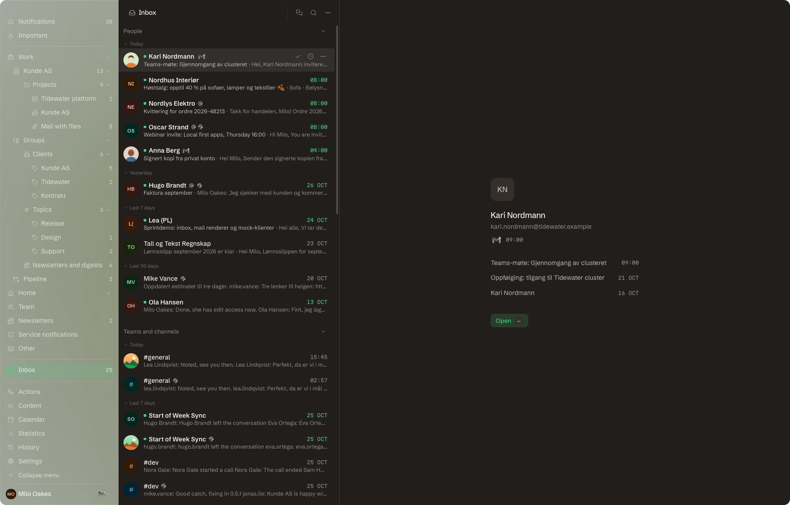
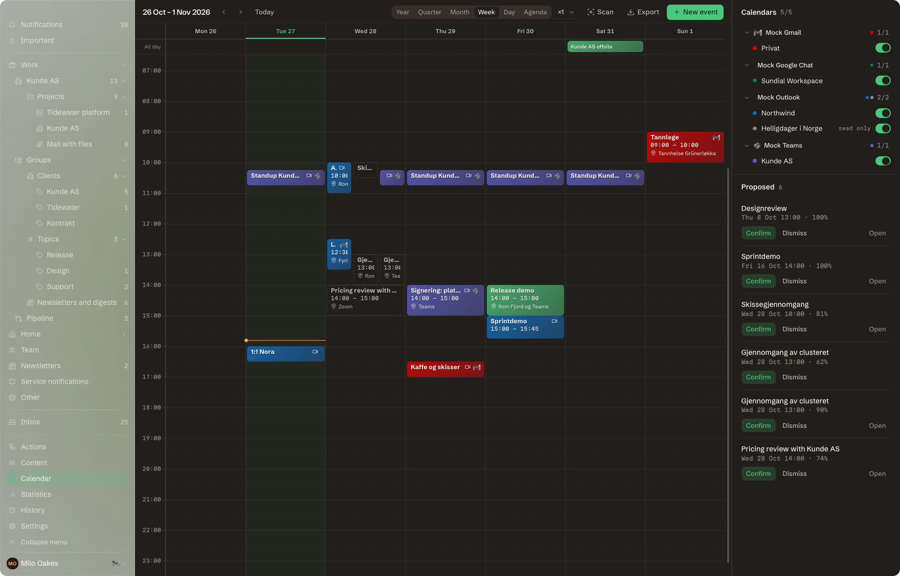
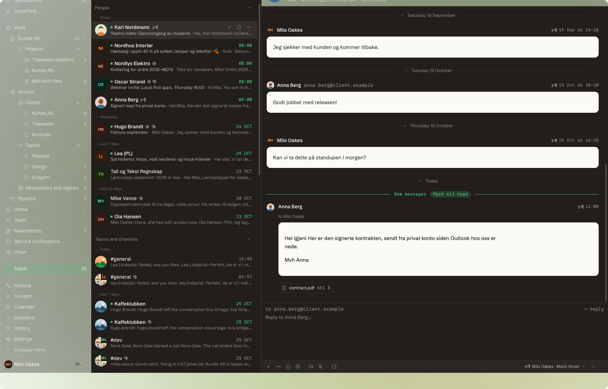
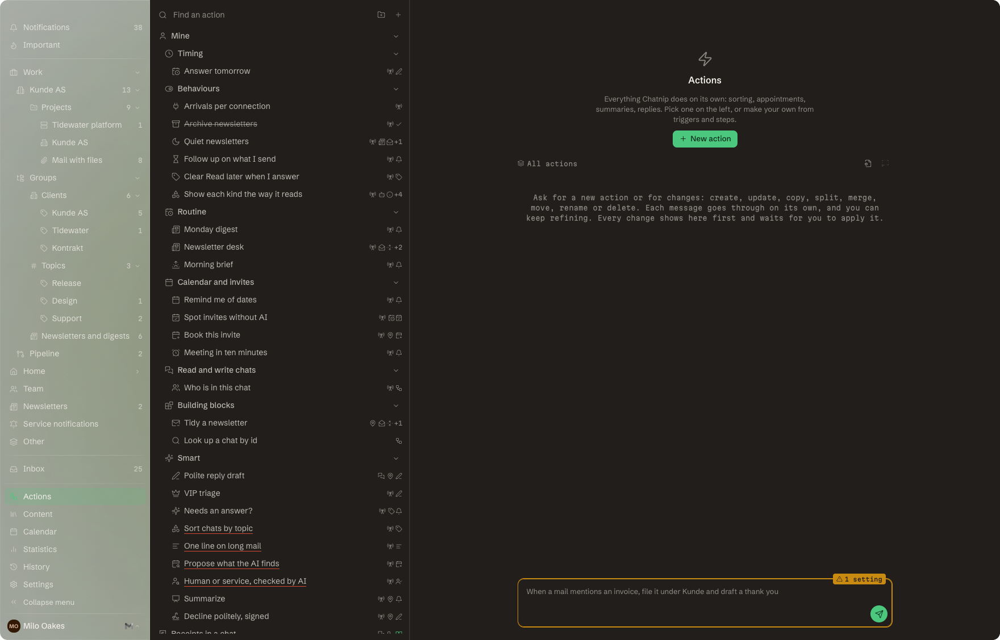

<div align="center">



# Chatnip

**Every inbox, one engine.** Outlook, Teams, Gmail, Slack, IMAP and your calendars in one fast, local, keyboard-first Mac app.

[Install](#install) · [Features](#features) · [Connect accounts](docs/connecting.md) · [Command line](docs/cli.md) · [Contributing](CONTRIBUTING.md)

</div>



## Why

You work across more than one organisation. Two Microsoft 365 tenants, a couple of Slack workspaces, a Gmail account and an old IMAP box, each in its own app, each showing one slice of your day. Chatnip pulls every conversation you are part of into one inbox, where the unit is the conversation and the network it lives on is just a fact about it. A reply goes back through whichever network each message came from.

Everything runs on your Mac. There is no Chatnip server and no account to create: the database is a local SQLite file, tokens live in the macOS Keychain, and nothing leaves the machine except the calls to the services you connect.

## Features

- **One inbox for every network.** Teams chats and channels, Outlook and Gmail threads, Slack channels and DMs, any IMAP mailbox. Several tenants and workspaces side by side.
- **Live.** Slack and IMAP push changes the moment they happen. Teams, Outlook and Gmail are checked for what changed, and only those conversations are fetched.
- **The same features everywhere.** Mentions, `@here`, `#channel`, threads with "also send to channel", reactions, edits, read state both ways, drafts, saved items, reminders and send later work the same on every network. Where a network has no native version, Chatnip does it locally.
- **People, not addresses.** Everyone you talk to becomes one person across every address and network they use, with one timeline of everything.
- **A real calendar.** Every calendar merged into one view from year down to day, the same meeting seen in several calendars shown once, meetings found in your mail proposed for you, invites answered in place.
- **Mail done right.** Signatures per account and alias (synced with Gmail), aliases, automatic replies, undo send, a renderer that keeps HTML mail readable in dark mode.
- **Actions.** Automations as graphs of triggers, built in steps and small scripts: sort into splits, find appointments, summarise mail, draft replies. Dry run them on a real message before switching them on.
- **Keyboard first.** A command palette, `j`/`k`, `g` jumps, `⌥↑`/`⌥↓` between conversations, search with `from:`, `in:`, `has:`, `is:`, `before:` and `after:`.
- **A command line and an MCP server.** The app is also the `chatnip` command: every feature as `chatnip <resource> <verb>`, tables on a terminal and JSON in a pipe, and the same commands as tools for Claude.
- **Raycast.** Inbox, search, reply, today's agenda and quick add, from Raycast.

<table>
<tr>
<td></td>
<td></td>
</tr>
<tr>
<td></td>
<td></td>
</tr>
</table>

## Install

```bash
brew install --cask slyotis/chatnip/chatnip
```

The cask installs `Chatnip.app` and puts `chatnip` (and the short `cnip`) on your PATH. Builds are signed and notarized. Chatnip needs macOS 11 or later.

To build it yourself, see [Building from source](#building-from-source).

## Connect your accounts

Open Settings, Connections and add an account. Microsoft 365 and Google sign in through your browser; Slack takes an app or a user token; any other mail account connects with IMAP and SMTP. Each service needs one app registration, which takes a few minutes and is described step by step in [docs/connecting.md](docs/connecting.md).

Want to look around first? Turn on the mock connections under Settings, Developer, or start the app with `CHATNIP_USE_DEBUG=true`. Six fake accounts with a full cast of people, chats, mail and meetings appear, and they answer back.

## The command line

```bash
chatnip conversations get --limit 10
chatnip search get --input '{"query":"from:anna has:file invoice"}'
chatnip message create --set input.conversation_id=ID --set input.content="On my way"
chatnip events get --input '{"start":"2026-11-01T00:00:00Z","end":"2026-11-08T00:00:00Z"}' --fields title,starts_at
chatnip plugin install          # the Claude Code plugin with the skill and the MCP server
```

The grammar is `chatnip <resource> <get|create|update|delete>`. Output is a table on a terminal and JSON in a pipe, with `--json`, `--jq`, `--template`, `--fields`, `--sort`, `--limit` and `--cursor` on every command. It runs through the open app, or starts the engine without a window when the app is closed. See [docs/cli.md](docs/cli.md) and `chatnip help`.

## Privacy and security

- Everything is stored locally, in `~/Library/Application Support/com.slyotis.chatnip`.
- Tokens and passwords are kept in the macOS Keychain, never in the database.
- Chatnip can lock behind Touch ID after a period of inactivity.
- AI features use tools already on your machine, such as the Claude Code CLI or a local Ollama; no hosted model is called unless you add one.

More in [docs/security.md](docs/security.md). To report a vulnerability, see [SECURITY.md](SECURITY.md).

## Building from source

You need Rust (stable), Node 22 with pnpm, and [just](https://github.com/casey/just).

```bash
just deps        # install dependencies
just dev         # run with hot reload
just check       # type check Rust and Svelte
just test        # Rust unit tests and Vitest
just test-e2e    # end to end tests on the mock accounts
just build       # a release build
```

Chatnip is a Tauri 2 app: a Rust engine with SQLite in `src-tauri`, and a Svelte 5 interface in `src`.

## Contributing

Pull requests are welcome. Read [CONTRIBUTING.md](CONTRIBUTING.md) first: it covers the setup, the tests a change must pass and how reviews work.

## License

[MIT](LICENSE) © Martin Ottersland. Third party notices are in [NOTICE.md](NOTICE.md).
